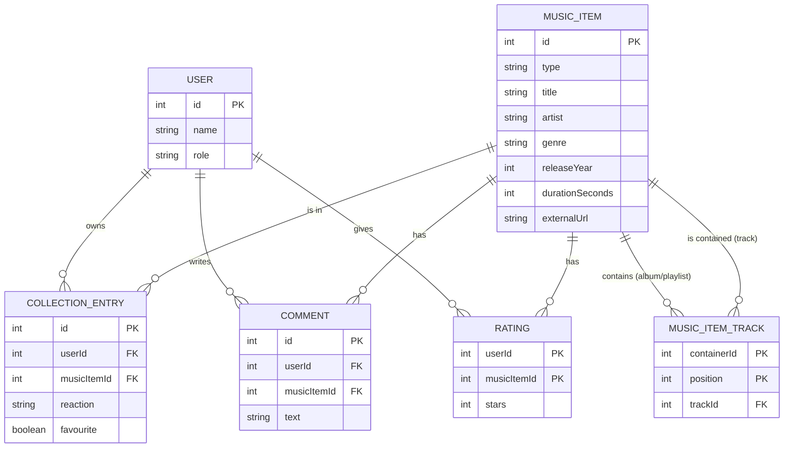

# Music Collection Manager – Backend Documentation

**KV Service Engineering WS 2026/2027 · Exercise 1 · Group 3 · Topic 4: NestJS**

Team: _<names and student IDs>_

Submission: 9 November 2026

---

## Contents

1. Introduction and requirements
2. Technology overview
3. Architecture
4. Data model and database
5. Data access with TypeORM
6. REST API and OpenAPI documentation
7. API design guidelines
8. Data transfer objects (DTOs)
9. Caller identification and roles
10. Error handling
11. Testing
12. Running the application
13. Design decisions and limitations

---

## 1. Introduction and Requirements

The Music Collection Manager lets users manage a personal music collection. This document describes the backend built in Exercise 1: business logic, database and REST API. The user interface follows in Exercise 2.

The requirements from the assignment sheet, and how we implemented them:

| Requirement                                                                   | Implementation                                                                                     |
| ----------------------------------------------------------------------------- | -------------------------------------------------------------------------------------------------- |
| A music item is a single track, an album, or a playlist of arbitrary length   | One `MusicItem` entity with a `type`; albums and playlists hold an ordered list of tracks          |
| Only metadata is managed; tracks are referenced                               | No audio is stored; `externalUrl` links to the actual music (e.g. Spotify)                         |
| Admin: add, update and remove any music from the collection                   | `POST`, `PUT` and `DELETE /music-items`, restricted to the `ADMIN` role                            |
| User: add music to their personal collection, mark like/dislike/favourite, remove it | `POST`, `PATCH` and `DELETE /users/{userId}/collection`, restricted to the owning user      |
| Overview of the music items of all users / one user                           | `GET /collections` and `GET /users/{userId}/collection`                                            |
| Comments and 5-star ratings on music items                                    | `/music-items/{id}/comments` and `/music-items/{id}/ratings`                                       |
| Registration, login, user management and UI are out of scope                  | Users are seeded; the caller is identified by an `X-User-Id` header (section 9)                    |

**How we read "the collection".** We read the sheet as describing two levels:

- **The catalogue.** This is the shared collection that the admin maintains. It contains all tracks, albums and playlists.
- **Personal collections.** Each user picks items from the catalogue into their own list and marks them there.

Users do not create music items themselves.

---

## 2. Technology Overview

| Technology                            | Version | Purpose                                                    |
| ------------------------------------- | ------- | ---------------------------------------------------------- |
| Node.js                               | 24      | Runtime                                                    |
| TypeScript                            | 6.0     | Language                                                   |
| NestJS                                | 12.1    | Backend framework                                          |
| TypeORM (`@nestjs/typeorm`)           | 1.1     | Object-relational mapper                                   |
| SQLite (`better-sqlite3`)             | –       | Embedded relational database                               |
| class-validator / class-transformer   | 0.15 / 0.5 | Declarative validation and type conversion of DTOs      |
| `@nestjs/swagger`                     | 12.0    | OpenAPI 3 documentation and Swagger UI                     |
| Vitest + Supertest                    | 4.1     | Unit and end-to-end tests                                  |

### Why NestJS

NestJS is a framework for server-side applications on Node.js. It runs on top of Express, which it uses by default, and adds a fixed application structure. Its main concepts are:

- **Modules** (`@Module`) group related code into one feature, for example the music items. Each module declares the modules it imports and the services it exports.
- **Controllers** (`@Controller`, `@Get`, `@Post`, ...) map HTTP routes to methods.
- **Providers / services** (`@Injectable`) contain the business logic. They are created and injected by NestJS's **dependency injection** container.
- **Guards** decide whether a request may reach a route. We use a guard for caller identification and roles.
- **Pipes** transform and validate input. We use the global `ValidationPipe`.
- **Exception filters** turn exceptions into HTTP responses.

The framework relies on TypeScript decorators: a class becomes a controller or an entity by annotation. This keeps the code declarative and makes it easy to generate documentation from it.

```ts
@Controller('music-items')
export class MusicItemsController {
  constructor(private readonly musicItemsService: MusicItemsService) {} // injected

  @Get(':id')
  findOne(@Param('id', ParseIntPipe) id: number): Promise<MusicItemDetailDto> {
    return this.musicItemsService.findOne(id);
  }
}
```

### Why TypeORM and SQLite

- **TypeORM** integrates closely with NestJS (`@nestjs/typeorm`) and uses the same decorator style for entities.
- **SQLite** needs no database server: the database is a single file, which makes the project easy to run and to grade.
- **Switching databases:** TypeORM abstracts the SQL dialect, so moving to PostgreSQL only means changing the connection configuration.

---

## 3. Architecture

The backend is split into feature modules. Each module follows the same layering:

```
HTTP request
   │
   ▼
Guard (AuthGuard)          → identifies the caller, checks @Roles
   │
   ▼
Pipe (ValidationPipe)      → converts and validates params, query and body into DTOs
   │
   ▼
Controller                 → maps the route, checks ownership, delegates
   │
   ▼
Service                    → business rules, transactions, entity ↔ DTO mapping
   │
   ▼
TypeORM Repository         → SQL against SQLite
```

Errors thrown in any layer are caught by the global `HttpExceptionFilter`, which returns them in one common format (section 10).

| Module               | Responsibility                                                       |
| -------------------- | -------------------------------------------------------------------- |
| `UsersModule`        | Seeded users, read-only endpoints; exports `UsersService`            |
| `MusicItemsModule`   | Catalogue (tracks, albums, playlists, track lists); exports `MusicItemsService` |
| `CollectionsModule`  | Personal collections with reaction and favourite                     |
| `CommentsModule`     | Comments on music items                                              |
| `RatingsModule`      | 1–5 star ratings                                                     |
| `common/`            | Auth guard, decorators, exception filter, pagination, error schema   |
| `seed/`              | Demo data on first start                                             |

Other modules use `MusicItemsService` to check that an item exists and to build item DTOs with their rating summaries. This keeps that logic in one place:

```ts
@Module({
  imports: [TypeOrmModule.forFeature([CollectionEntry]), UsersModule, MusicItemsModule],
  controllers: [CollectionsController],
  providers: [CollectionsService],
})
export class CollectionsModule {}
```

---

## 4. Data Model and Database

### Entity-relationship diagram



### Entities

| Entity            | Key fields                                                                                    | Constraints                                                     |
| ----------------- | --------------------------------------------------------------------------------------------- | --------------------------------------------------------------- |
| `User`            | `id`, `name`, `role` (`ADMIN` \| `USER`)                                                      | –                                                               |
| `MusicItem`       | `id`, `type` (`TRACK` \| `ALBUM` \| `PLAYLIST`), `title`, `artist?`, `genre?`, `releaseYear?`, `durationSeconds?`, `externalUrl?`, `createdAt`, `updatedAt` | –                    |
| `MusicItemTrack`  | `containerId`, `position`, `trackId`                                                          | Primary key (`containerId`, `position`); both foreign keys `ON DELETE CASCADE` |
| `CollectionEntry` | `id`, `userId`, `musicItemId`, `reaction` (`NONE` \| `LIKE` \| `DISLIKE`), `favourite`, `addedAt` | Unique (`userId`, `musicItemId`); foreign keys `ON DELETE CASCADE` |
| `Comment`         | `id`, `userId`, `musicItemId`, `text`, `createdAt`                                            | Foreign keys `ON DELETE CASCADE`                                |
| `Rating`          | `userId`, `musicItemId`, `stars`, `updatedAt`                                                 | Primary key (`userId`, `musicItemId`) → one rating per user and item |

### Modelling decisions

- **One table for all music items.** Tracks, albums and playlists share most fields, and all three can be collected, commented on and rated. A single table with a `type` discriminator means collections, comments and ratings need only one foreign key to `MusicItem`. Separate tables per type would have required three.
- **Ordered track lists as a join entity.** An album or playlist references its tracks through `MusicItemTrack` and stores the `position` explicitly. A plain many-to-many relation could not store the order, and playlists can contain any number of tracks.
- **Reaction and favourite are two fields.** `reaction` is `NONE`, `LIKE` or `DISLIKE`, and `favourite` is a boolean. This allows "liked and favourite". The contradictory combination `DISLIKE` + favourite is rejected by the business logic.
- **Constraints in the database.** Uniqueness and "one rating per user" are enforced by keys, not only in code. `ON DELETE CASCADE` means that deleting a catalogue item also removes it from all collections, track lists, comments and ratings.
- **Computed values are not stored.** The duration of an album or playlist and the average rating of an item are calculated when they are read, so they cannot go out of sync.

---

## 5. Data Access with TypeORM

### Connection

The connection is configured once in the root module. `autoLoadEntities` registers every entity that a module declares with `forFeature`:

```ts
TypeOrmModule.forRoot({
  type: 'better-sqlite3',
  database: process.env.DB_PATH ?? 'music.sqlite',
  autoLoadEntities: true,
  synchronize: true, // creates/updates tables from the entities
}),
```

`synchronize` derives the schema from the entity classes at startup. That suits this exercise; a production system would use migrations instead.

### Entities

Entities are classes annotated with decorators. The relation from a track list entry to its album or playlist and to its track:

```ts
@Entity()
export class MusicItemTrack {
  @PrimaryColumn() containerId: number;
  @PrimaryColumn() position: number;
  @Column() trackId: number;

  @ManyToOne(() => MusicItem, (item) => item.tracks, { onDelete: 'CASCADE' })
  @JoinColumn({ name: 'containerId' })
  container: Relation<MusicItem>;

  @ManyToOne(() => MusicItem, { onDelete: 'CASCADE' })
  @JoinColumn({ name: 'trackId' })
  track: Relation<MusicItem>;
}
```

The collection entry with its unique constraint and defaults:

```ts
@Entity()
@Unique(['userId', 'musicItemId'])
export class CollectionEntry {
  @PrimaryGeneratedColumn() id: number;
  @Column() userId: number;
  @Column() musicItemId: number;

  @Column({ type: 'simple-enum', enum: Reaction, default: Reaction.NONE })
  reaction: Reaction;

  @Column({ default: false })
  favourite: boolean;

  @ManyToOne(() => User, { onDelete: 'CASCADE' })
  @JoinColumn({ name: 'userId' })
  user: Relation<User>;
  // musicItem relation analogous
}
```

The foreign key columns (`userId`, `musicItemId`) are declared explicitly next to the relations. This lets us filter and insert by id without loading the related entities. The `Relation<T>` wrapper avoids circular import problems between entity files in ES modules.

### Repositories

Services get a typed `Repository<Entity>` injected via `@InjectRepository`. Most queries use the find API. Filtering, eager loading of relations, sorting and pagination are a single call:

```ts
const [items, total] = await this.items.findAndCount({
  where,                                        // e.g. { type: 'ALBUM', title: Like('%road%') }
  relations: { tracks: { track: true } },       // JOINs the track list and its tracks
  order: { id: 'ASC', tracks: { position: 'ASC' } },
  skip: query.skip,
  take: query.limit,
});
```

The query builder is used where the find API is not enough, for example to calculate the rating averages of many items in one grouped query:

```ts
const rows = await this.ratings
  .createQueryBuilder('rating')
  .select('rating.musicItemId', 'musicItemId')
  .addSelect('AVG(rating.stars)', 'average')
  .addSelect('COUNT(*)', 'count')
  .where({ musicItemId: In(ids) })
  .groupBy('rating.musicItemId')
  .getRawMany();
```

### Transactions

Creating or replacing an album or playlist writes the item and its track list. Both writes run in one transaction, so a failure cannot leave half a track list behind:

```ts
await this.dataSource.transaction(async (manager) => {
  await manager.update(MusicItem, id, this.toColumns(dto));
  await manager.delete(MusicItemTrack, { containerId: id });
  await manager.insert(MusicItemTrack, trackIds.map((trackId, i) => ({
    containerId: id, trackId, position: i + 1,
  })));
});
```

---

## 6. REST API and OpenAPI Documentation

All endpoints are under the base path `/api/v1`. Every request needs an `X-User-Id` header (section 9), except the public `GET /users`.

### Endpoints

**Music items (catalogue)**

| Method | Path                | Role  | Success | Description                                               |
| ------ | ------------------- | ----- | ------- | --------------------------------------------------------- |
| GET    | `/music-items`      | any   | 200     | List; filters `type`, `search`; pagination `page`, `limit` |
| GET    | `/music-items/{id}` | any   | 200     | Item including its ordered track list                     |
| POST   | `/music-items`      | ADMIN | 201     | Create a track, album or playlist                         |
| PUT    | `/music-items/{id}` | ADMIN | 200     | Replace metadata and track list                           |
| DELETE | `/music-items/{id}` | ADMIN | 204     | Delete; cascades to collections, comments, ratings        |

**Collections**

| Method | Path                                  | Role       | Success | Description                                  |
| ------ | ------------------------------------- | ---------- | ------- | -------------------------------------------- |
| GET    | `/collections`                        | any        | 200     | Entries of all users; filters `reaction`, `favourite` |
| GET    | `/users/{userId}/collection`          | any        | 200     | Entries of one user; same filters            |
| POST   | `/users/{userId}/collection`          | USER (own) | 201     | Add a catalogue item                         |
| PATCH  | `/users/{userId}/collection/{itemId}` | USER (own) | 200     | Set `reaction` and/or `favourite`            |
| DELETE | `/users/{userId}/collection/{itemId}` | USER (own) | 204     | Remove from the collection                   |

`{itemId}` is the id of the music item, so a client never needs to know internal entry ids.

**Comments, ratings, users**

| Method | Path                                 | Role      | Success   | Description                          |
| ------ | ------------------------------------ | --------- | --------- | ------------------------------------ |
| GET    | `/music-items/{id}/comments`         | any       | 200       | Comments, newest first, paginated    |
| POST   | `/music-items/{id}/comments`         | any       | 201       | Comment as the current user          |
| GET    | `/music-items/{id}/ratings`          | any       | 200       | Average, count and all ratings       |
| PUT    | `/music-items/{id}/ratings/{userId}` | any (own) | 201 / 200 | Create (201) or replace (200) own rating |
| GET    | `/users`                             | public    | 200       | Seeded users, no header needed       |
| GET    | `/users/{id}`                        | any       | 200       | One seeded user                      |

### Controller implementation

Controllers are thin: they declare the route, the required role and the documentation, check ownership, and delegate to the service.

```ts
@Patch('users/:userId/collection/:itemId')
@Roles(Role.USER)
@ApiOperation({ summary: 'Mark an item in your collection as liked/disliked and/or favourite' })
@ApiOkResponse({ type: CollectionEntryDto })
@ApiErrors(400, 403, 404)
update(
  @CurrentUser() caller: User,
  @Param('userId', ParseIntPipe) userId: number,
  @Param('itemId', ParseIntPipe) itemId: number,
  @Body() dto: UpdateCollectionEntryDto,
): Promise<CollectionEntryDto> {
  assertOwner(caller, userId);
  return this.collectionsService.update(userId, itemId, dto);
}
```

The business rule itself lives in the service:

```ts
const reaction = dto.reaction ?? entry.reaction;
const favourite = dto.favourite ?? entry.favourite;
if (reaction === Reaction.DISLIKE && favourite) {
  throw new BadRequestException('A disliked item cannot be a favourite');
}
```

### OpenAPI

The OpenAPI 3 document is **generated from the code** by `@nestjs/swagger`. It doesn't need to be maintained separately:

- `@ApiTags`, `@ApiOperation` and `@ApiOkResponse` / `@ApiCreatedResponse` describe the operations.
- `@ApiProperty` on the DTO classes produces the schemas, including examples, enums, nullability and value ranges.
- `@ApiErrors(...)`, our own decorator, adds the documented error responses with the shared error schema.
- The `X-User-Id` header is declared as an API key security scheme, so the Swagger UI offers an "Authorize" button.

```ts
const config = new DocumentBuilder()
  .setTitle('Music Collection Manager API')
  .setVersion('1.0')
  .addApiKey({ type: 'apiKey', in: 'header', name: 'X-User-Id' }, 'user-id')
  .addSecurityRequirements('user-id')
  .build();
SwaggerModule.setup('api/docs', app, () => SwaggerModule.createDocument(app, config));
```

- Swagger UI: `http://localhost:3000/api/docs`
- OpenAPI JSON: `http://localhost:3000/api/docs-json`

The Vue frontend in Exercise 2 can use the JSON file to generate a typed client.

---

## 7. API Design Guidelines

We followed the Swagger "Best Practices in API Design" guidelines:

| Guideline                                  | Application in our API                                                                  |
| ------------------------------------------ | --------------------------------------------------------------------------------------- |
| Resources are nouns, not verbs             | `/music-items`, `/collections`, `/comments`; no `/addToCollection`                      |
| Plural names for collections               | `/music-items`, `/users`, `/ratings`                                                    |
| HTTP methods express the operation         | `GET` read, `POST` create, `PUT` replace, `PATCH` partial update, `DELETE` remove       |
| Nesting shows relationships                | `/users/{userId}/collection`, `/music-items/{id}/comments`                              |
| Meaningful status codes                    | 201 on create, 204 on delete, 400/401/403/404/409 for errors (section 10)               |
| Idempotent `PUT`                           | Rating `PUT` creates or replaces; repeating it gives the same state                     |
| Filtering, sorting and pagination          | `?type=`, `?search=`, `?reaction=`, `?favourite=`, `?page=`, `?limit=` (max 100)        |
| Versioning                                 | Base path `/api/v1`                                                                     |
| Consistent error format                    | One error schema for all errors                                                         |

---

## 8. Data Transfer Objects (DTOs)

DTOs are classes that describe the shape of requests and responses. Entities are never sent to the client directly. This keeps the API stable when the database changes and hides internal fields.

### Request DTOs and validation

Request DTOs are validated by the global `ValidationPipe`:

```ts
new ValidationPipe({
  whitelist: true,              // strips properties without decorators
  forbidNonWhitelisted: true,   // ...and rejects the request if there are any
  transform: true,              // converts plain JSON / query strings into DTO instances
});
```

The same decorators define the validation rules and the OpenAPI schema:

```ts
export class RateDto {
  @ApiProperty({ minimum: 1, maximum: 5, example: 4 })
  @IsInt()
  @Min(1)
  @Max(5)
  stars: number;
}

export class UpdateCollectionEntryDto {
  @ApiPropertyOptional({ enum: Reaction, example: Reaction.LIKE })
  @IsOptional()
  @IsEnum(Reaction)
  reaction?: Reaction;

  @ApiPropertyOptional({ example: true })
  @IsOptional()
  @IsBoolean()
  favourite?: boolean;
}
```

Query parameters are DTOs too. `PaginationQueryDto` converts `page` and `limit` from strings to numbers, applies defaults (1 and 20) and enforces limits. Resource-specific query DTOs extend it:

```ts
export class MusicItemQueryDto extends PaginationQueryDto {
  @IsOptional() @IsEnum(MusicItemType) type?: MusicItemType;
  @IsOptional() @IsString() @MaxLength(200) search?: string;
}
```

Rules that need the database are checked in the service rather than in the DTO. Examples: the ids in `trackIds` must exist and be tracks, and the type of an item cannot change.

### Request DTO overview

| DTO                        | Used by                                    | Fields                                                              |
| -------------------------- | ------------------------------------------ | ------------------------------------------------------------------- |
| `CreateMusicItemDto`       | `POST /music-items`                        | `type`, `title`, `artist?`, `genre?`, `releaseYear?`, `durationSeconds?`, `externalUrl?`, `trackIds?` |
| `UpdateMusicItemDto`       | `PUT /music-items/{id}`                    | Same as create (full replacement)                                   |
| `AddCollectionEntryDto`    | `POST /users/{userId}/collection`          | `musicItemId`                                                       |
| `UpdateCollectionEntryDto` | `PATCH /users/{userId}/collection/{itemId}` | `reaction?`, `favourite?`                                          |
| `CreateCommentDto`         | `POST /music-items/{id}/comments`          | `text` (1–2000 characters)                                          |
| `RateDto`                  | `PUT /music-items/{id}/ratings/{userId}`   | `stars` (integer 1–5)                                               |

### Response DTOs

Response DTOs contain computed fields such as `durationSeconds` for albums, `trackCount`, `averageRating` and `ratingCount`, and nest related data where the client needs it.

Example: `GET /api/v1/music-items/6`

```json
{
  "id": 6,
  "type": "ALBUM",
  "title": "Abbey Road",
  "artist": "The Beatles",
  "genre": "Rock",
  "releaseYear": 1969,
  "durationSeconds": 626,
  "externalUrl": "https://open.spotify.com/album/0ETFjACtuP2ADo6LFhL6HN",
  "trackCount": 3,
  "averageRating": 4.5,
  "ratingCount": 2,
  "createdAt": "2026-10-13T21:13:25.000Z",
  "updatedAt": "2026-10-13T21:13:25.000Z",
  "tracks": [
    {
      "position": 1,
      "track": { "id": 1, "type": "TRACK", "title": "Come Together", "durationSeconds": 259, "...": "..." }
    }
  ]
}
```

### Paginated lists

All list endpoints that can grow return the same envelope:

```json
{
  "data": [ { "user": { "id": 2, "name": "Anna", "role": "USER" }, "musicItem": { "...": "..." }, "reaction": "LIKE", "favourite": true, "addedAt": "..." } ],
  "meta": { "page": 1, "limit": 20, "total": 4 }
}
```

Swagger cannot document TypeScript generics, so a small helper creates a concrete class per item type, such as `CollectionEntryDtoPage`:

```ts
export function PageDto<T>(itemType: Type<T>): Type<Page<T>> {
  class PageOfItems implements Page<T> {
    @ApiProperty({ type: [itemType] }) data: T[];
    @ApiProperty({ type: PageMetaDto }) meta: PageMetaDto;
  }
  Object.defineProperty(PageOfItems, 'name', { value: `${itemType.name}Page` });
  return PageOfItems;
}
```

---

## 9. Caller Identification and Roles

Login is not part of Exercise 1, but the roles are. As a stand-in, the client sends the id of a seeded user in the `X-User-Id` header.

A global guard (`AuthGuard`, registered as `APP_GUARD`) handles every request:

1. It reads `X-User-Id` and loads the user. A missing or unknown id returns **401**.
2. It attaches the user to the request, so controllers can inject it with `@CurrentUser()`.
3. It checks the roles declared with `@Roles(...)`. A caller without the required role gets **403**.

Endpoints marked with `@Public()` skip these steps. Only `GET /users` is public: a client needs the list of users before it can pick one.

```ts
const roles = this.reflector.getAllAndOverride<Role[] | undefined>(ROLES_KEY, [
  context.getHandler(),
  context.getClass(),
]);
if (roles && !roles.includes(user.role)) {
  throw new ForbiddenException(`Requires role ${roles.join(' or ')}`);
}
```

The role is **read from the stored user, not sent by the client**. This way a request cannot claim to be user 2 with the role `ADMIN`.

On personal resources (collections, own rating), the controller also calls `assertOwner(caller, userId)`. A user acting on someone else's data gets **403**.

In a later exercise, the guard can be replaced with real authentication (for example JWT) without changing the controllers.

---

## 10. Error Handling

A global exception filter returns every error in the same format. This makes errors easy for the frontend to handle:

```json
{
  "statusCode": 400,
  "error": "Bad Request",
  "message": "A disliked item cannot be a favourite",
  "path": "/api/v1/users/2/collection/8",
  "timestamp": "2026-10-13T21:13:26.151Z"
}
```

For validation errors, `message` is a list of all problems, for example `["stars must not be greater than 5"]`. Unexpected errors are logged and returned as 500 without internal details.

| Status | Meaning                    | Example                                                             |
| ------ | -------------------------- | ------------------------------------------------------------------- |
| 400    | Invalid input              | `stars: 6`; unknown property; playlist with a non-track id; DISLIKE + favourite |
| 401    | Caller not identified      | Missing or unknown `X-User-Id`                                      |
| 403    | Not allowed                | User creates a music item; user edits another user's collection     |
| 404    | Resource not found         | Unknown music item, user or collection entry                        |
| 409    | Conflict                   | Item already in the collection                                      |

---

## 11. Testing

| Suite                    | Command            | Content                                                                    |
| ------------------------ | ------------------ | -------------------------------------------------------------------------- |
| Unit tests               | `npm test`         | `AuthGuard`: missing/unknown user, user attached to request, role check    |
| End-to-end tests         | `npm run test:e2e` | The full application against an in-memory SQLite database with seed data   |

The end-to-end tests send real HTTP requests with Supertest. They cover:

- authentication (401) and roles (403)
- pagination and filtering
- validation of track lists
- the collection workflow: add, duplicate (409), another user's collection (403), DISLIKE + favourite (400), mark, remove
- creating versus replacing a rating (201 / 200)
- the cascade when a catalogue item is deleted

A GitHub Actions workflow runs lint, build and both test suites on pull requests and on pushes to `master`.

---

## 12. Running the Application

```bash
cd backend
npm install
npm run start:dev
```

- API: `http://localhost:3000/api/v1`
- Swagger UI: `http://localhost:3000/api/docs`

On first start, the SQLite file `backend/music.sqlite` is created and filled with demo data:

- **Users:** `1` = Admin (ADMIN), `2` = Anna (USER), `3` = Ben (USER)
- **Catalogue:** five tracks, the album "Abbey Road" and the playlist "Road Trip"
- **Activity:** sample collection entries, comments and ratings

Deleting the file resets the data. Example request:

```bash
curl -H "X-User-Id: 2" "http://localhost:3000/api/v1/music-items?type=ALBUM"
```

---

## 13. Design Decisions and Limitations

| Decision                                         | Reason                                                                               |
| ------------------------------------------------ | ------------------------------------------------------------------------------------ |
| Admin maintains the catalogue; users only pick from it | Literal reading of the assignment's role descriptions                          |
| Reaction and favourite as two fields, DISLIKE + favourite rejected | Allows "liked and favourite" but blocks the contradiction          |
| One table for all music item types               | Collections, comments and ratings need only one foreign key                          |
| Explicit `position` in track lists               | Playlists are ordered and of arbitrary length                                        |
| `PUT` for music items, `PATCH` for collection entries | Items are replaced as a whole; marks are changed individually                   |
| Ratings via `PUT .../ratings/{userId}`           | One rating per user and item, idempotent                                             |
| Role taken from the database, not from a header  | A client cannot raise its own role                                                   |

Limitations, all outside the scope of Exercise 1:

- **No real authentication.** The `X-User-Id` header can be set by anyone.
- **Schema created with `synchronize`.** There are no migrations, and SQLite is a single-user database file.
- **No management endpoints for comments.** Comments cannot be edited or deleted; the assignment only asks for adding them.
